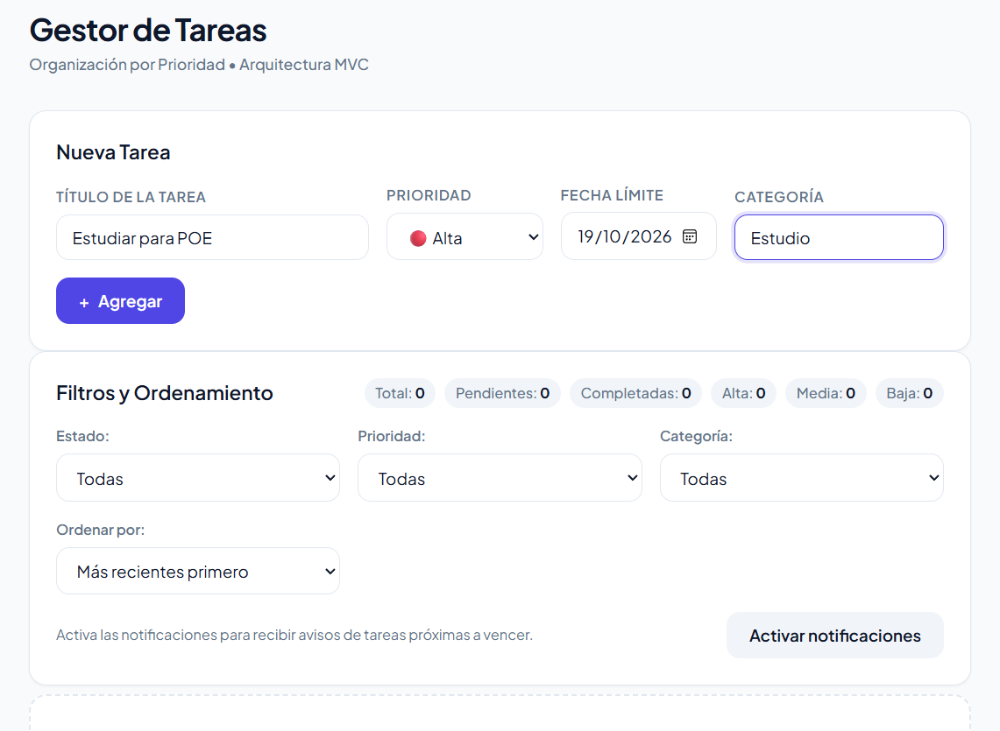
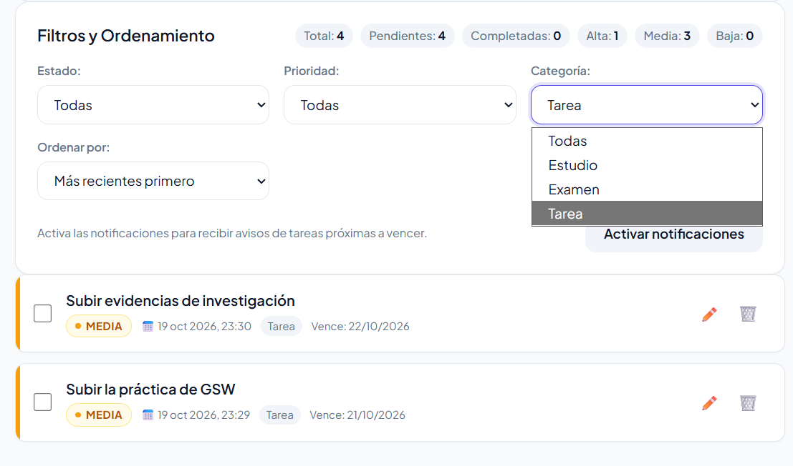
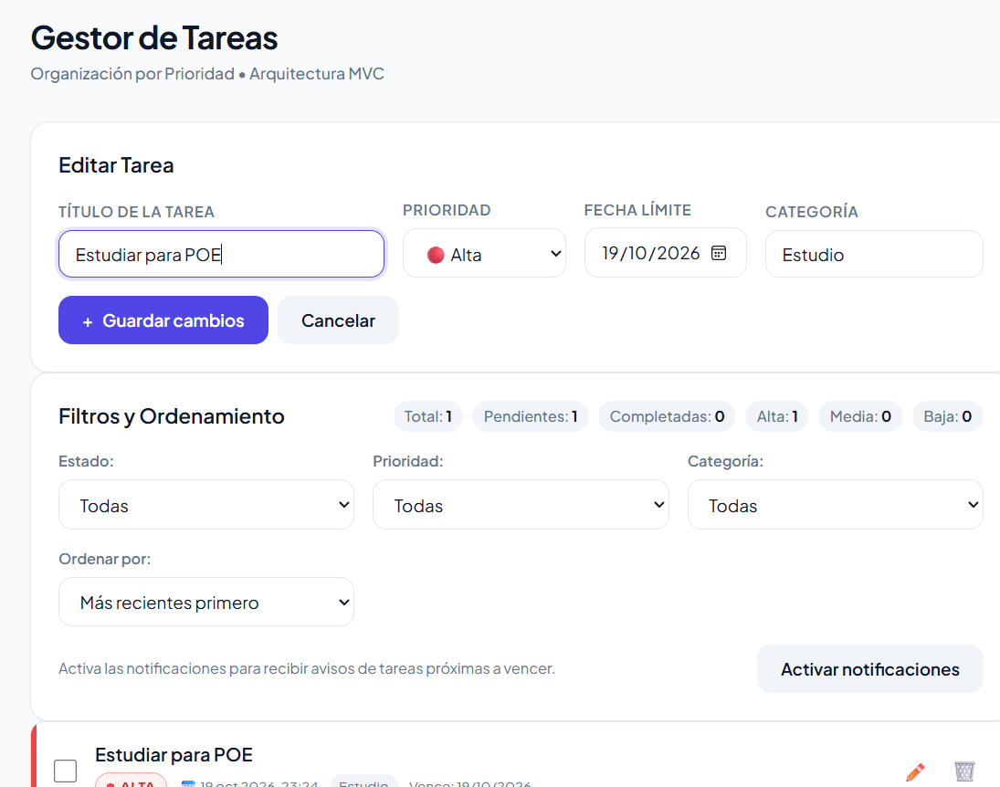
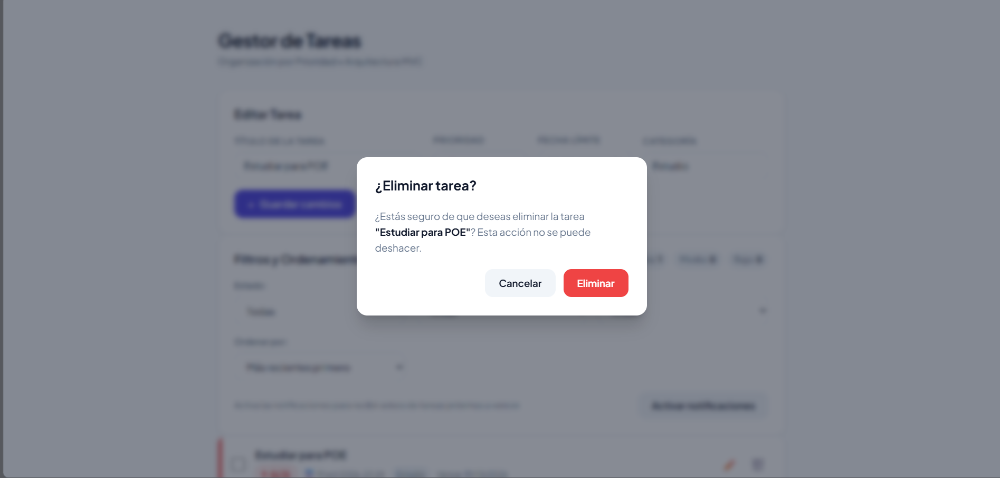

# Gestor de Tareas por Prioridad

## Capturas de pantalla

| Crear tareas | Filtrar tareas |
| --- | --- |
|  |  |

| Editar tareas | Confirmar eliminación |
| --- | --- |
|  |  |

Aplicación web desarrollada con **TypeScript**, **Vite** y arquitectura **Modelo-Vista-Controlador (MVC)**. Esta actualización amplía el gestor del laboratorio con fechas límite, categorías, edición, filtros combinables, nuevos criterios de ordenamiento, alertas de vencimiento y notificaciones del navegador.

## Mejoras de esta actualización

| Requisito | Implementación |
| --- | --- |
| **RF-01 — Fecha límite y categoría** | Cada tarea puede tener una fecha límite opcional y una categoría. Si no se especifica categoría, se asigna **General**. |
| **RF-02 — Editar tareas** | El botón de edición carga la tarea en el formulario; guardar conserva su fecha de creación y actualiza sus demás campos. |
| **RF-03 — Eliminar con confirmación** | La eliminación conserva el diálogo de confirmación para prevenir borrados accidentales. |
| **RF-04 — Filtros** | Se pueden combinar los filtros de prioridad, categoría y estado (todas, pendientes o completadas). |
| **RF-05 — Ordenamiento** | Las tareas se ordenan por prioridad, fecha límite, título o fecha de creación, en orden ascendente o descendente cuando aplica. |
| **RF-06 — Persistencia** | El servicio guarda automáticamente las tareas en `localStorage`, incluidos su fecha límite y categoría. |
| **RF-07 — Contadores por prioridad** | El resumen muestra el total de tareas de prioridad alta, media y baja, además de los contadores de estado. |
| **RF-09 — Tareas vencidas** | Las tareas pendientes con fecha límite anterior al día actual se identifican con texto y fondo rojos. Las completadas no se consideran vencidas. |
| **Reto — Notificaciones** | El usuario puede activar notificaciones del navegador para recibir un aviso cuando una tarea pendiente vence hoy o mañana. |

Las sub-tareas del requisito opcional RF-08 no se incluyen en esta entrega.

### Notificaciones del navegador

Las notificaciones son opcionales y requieren que el usuario pulse **Activar notificaciones** y conceda permiso en el navegador. Se comprueban mientras la aplicación está abierta y se muestra como máximo un aviso por tarea y fecha límite. El navegador puede requerir un contexto seguro (`localhost` o HTTPS); si no admite notificaciones o se deniega el permiso, el estado se comunica en la interfaz.

## Arquitectura MVC

La separación entre modelo, vista, controlador y servicio de almacenamiento permite mantener la lógica de negocio independiente de la interfaz y de la persistencia.

```text
┌─────────────────┐       Eventos UI       ┌─────────────────────┐
│    TareaView    ├───────────────────────►│   TareaController   │
│     (Vista)     │◄───────────────────────┤    (Controlador)    │
└─────────────────┘   Renderiza datos      └────┬───────────┬────┘
                                                │           │
                                                ▼           ▼
                                       ┌──────────────┐ ┌────────────────┐
                                       │    Tarea     │ │ StorageService │
                                       │   (Modelo)   │ │   (Servicio)   │
                                       └──────────────┘ └───────┬────────┘
                                                                ▼
                                                        ┌──────────────┐
                                                        │ localStorage │
                                                        └──────────────┘
```

### Componentes y responsabilidades

1. **Entidad — `src/models/Tarea.ts`**
   - Define los datos de una tarea: `id`, `titulo`, `prioridad`, `completada`, `fecha` de creación, `fechaLimite` y `categoria`.
   - Valida título, prioridad, categoría y fecha límite; calcula el peso de prioridad y determina si una tarea pendiente está vencida.
   - Reconstruye los datos guardados, incluidos los registros del formato anterior.
2. **Modelo de tareas — `src/models/TareaModel.ts`**
   - Administra la colección y centraliza `updateTarea()`, `deleteTarea()`, `getTareasVencidas()` y `getContadorPorPrioridad()`.
3. **Vista — `src/views/TareaView.ts`**
   - Renderiza las tarjetas, distintivos de prioridad, categoría y alertas de vencimiento.
   - Administra el formulario compartido de creación y edición, los controles de filtros, los contadores y el diálogo de confirmación.
   - Muestra el estado y la activación de las notificaciones del navegador.
4. **Controlador — `src/controllers/TareaController.ts`**
   - Coordina creación, edición, cambio de estado y eliminación de tareas.
   - Aplica filtros combinados y ordena por prioridad, fecha límite, título o fecha de creación.
   - Calcula los contadores por prioridad y programa la revisión de tareas próximas a vencer.
5. **Servicio — `src/services/StorageService.ts`**
   - Encapsula la lectura y escritura de tareas en `localStorage` y reconstruye instancias del modelo.

### Compatibilidad de datos

Las tareas guardadas antes de esta actualización se conservan. Al cargarlas, las que no tengan los nuevos campos reciben la categoría **General** y quedan sin fecha límite.

## Estructura del proyecto

```text
poe-lab2/
├── index.html
├── package.json
├── tsconfig.json
├── pnpm-lock.yaml
├── README.md
└── src/
    ├── main.ts
    ├── models/
    │   ├── Tarea.ts
    │   └── TareaModel.ts
    ├── views/
    │   └── TareaView.ts
    ├── controllers/
    │   └── TareaController.ts
    ├── services/
    │   └── StorageService.ts
    └── styles/
        └── styles.css
```

## Requisitos y puesta en marcha

### Prerrequisitos

- [Node.js](https://nodejs.org/) versión 18 o superior.
- [pnpm](https://pnpm.io/) versión 9 o superior.

### Instalar dependencias

```bash
pnpm install
```

### Ejecutar en desarrollo

```bash
pnpm dev
```

Abre en el navegador la dirección local que muestra Vite, normalmente `http://localhost:5173`.

### Compilar y validar tipos

```bash
pnpm build
```

### Previsualizar la compilación

```bash
pnpm preview
```

## Funcionalidades base conservadas

- Registro de tareas con título y niveles de prioridad **alta**, **media** y **baja**.
- Identificación visual de las prioridades mediante distintivos y colores.
- Cambio reactivo entre tareas pendientes y completadas.
- Filtrado por estado y prioridad, ahora ampliado con categoría.
- Ordenamiento por prioridad y fecha, ahora ampliado con fecha límite y título.
- Eliminación protegida por confirmación.
- Persistencia automática en el almacenamiento local del navegador.
